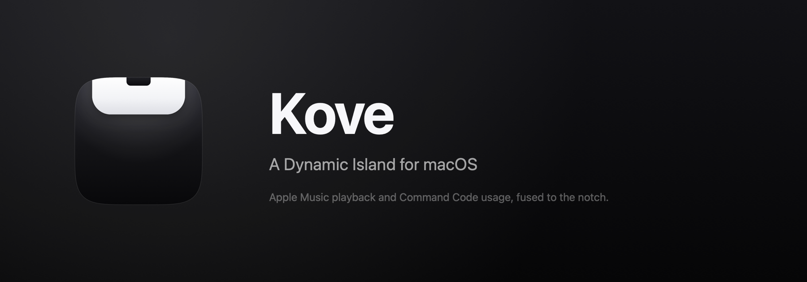
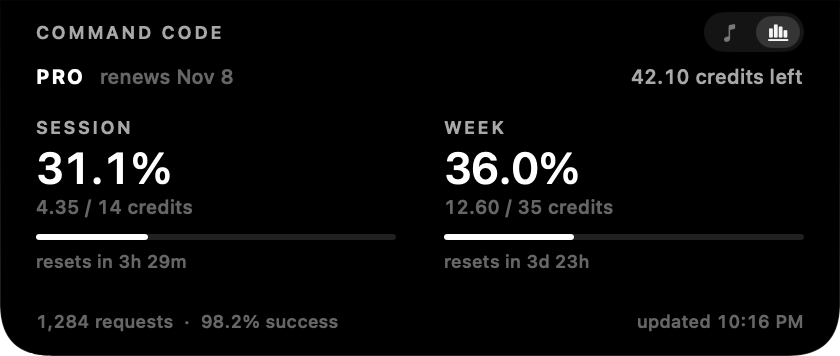
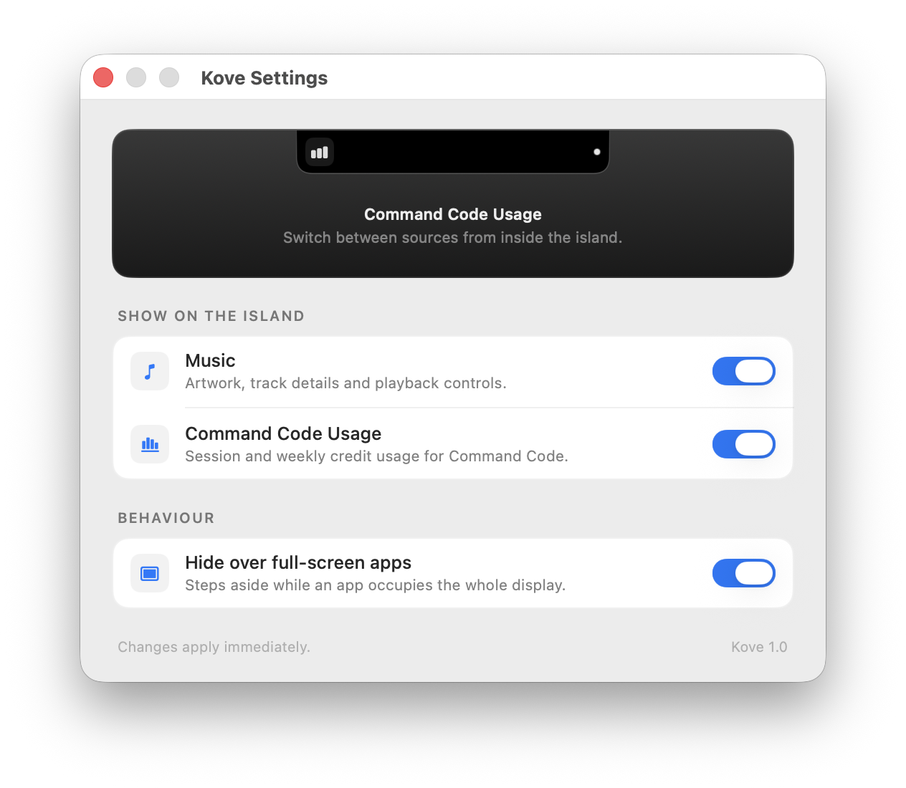
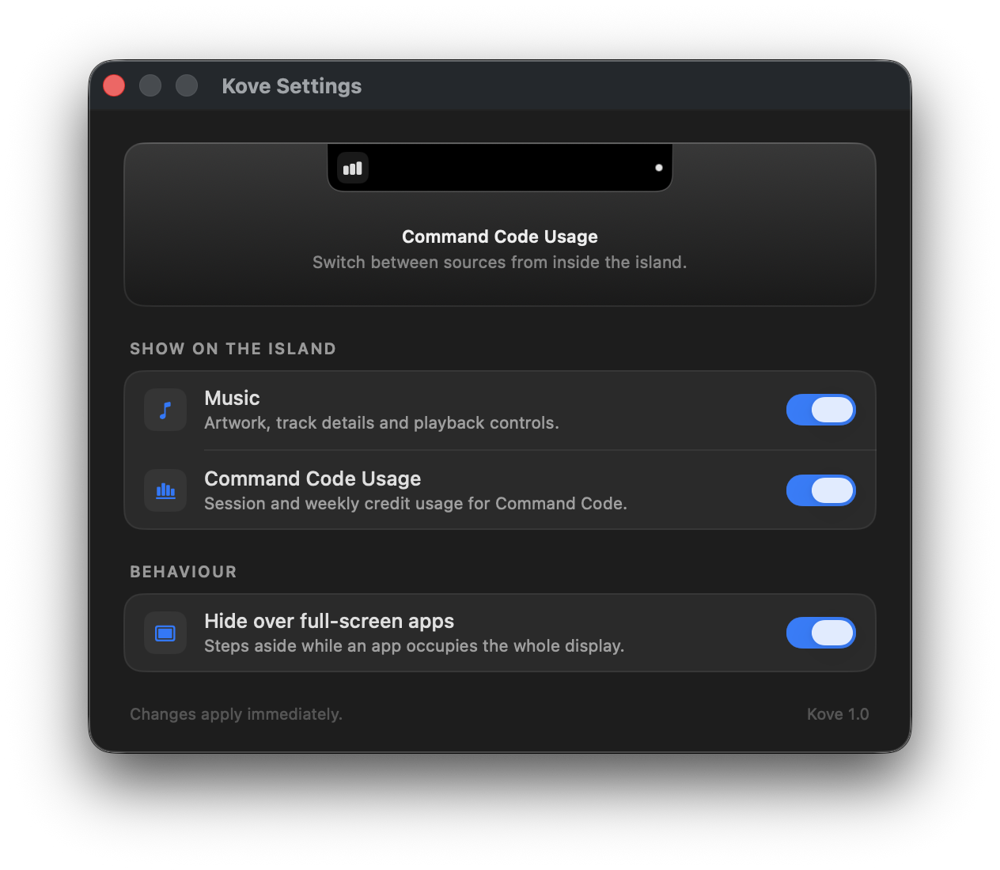

<div align="center">
  
</div>

<div align="center">


[](https://github.com/ValenscoA/Kove/actions/workflows/build.yml)

</div>

A black pill fused to the top edge of the notched display that expands into a small
panel showing what's playing (Apple Music, Spotify, or any player Kove knows how to
talk to) or how much Command Code usage you have left. It never takes focus, it's
click-through everywhere except the pill, and it steps aside for full-screen apps.

<br>

<div align="center">
  
  <p><sub>Usage figures in this screenshot are sample data.</sub></p>
</div>

<br>

## Features

**Notch-native panel.** A borderless `NSPanel` pinned above the menu bar on the
notched display. Clicks land on the pill and nowhere else, so the invisible part of
the panel can never swallow a click meant for the app underneath. It joins all
spaces, ignores app switches, and raises no Dock icon.

**Any player, live.** Artwork, title, artist, album, a scrubbable progress bar and
transport controls. Players are adapters behind one `MediaPlayer` protocol: Apple
Music and Spotify today, and adding another is a single file. Whichever player is
*playing* wins, a paused one keeps the pill on the notch so playback can be resumed
from it, and each player's own change notification (`com.apple.Music.playerInfo`,
`com.spotify.client.PlaybackStateChanged`) triggers an immediate read, so pressing
play puts the island on screen in a fraction of a second. A lazy poll (1.8–2.5 s)
stays as the backstop.

**Command Code usage.** Session (5 h) and weekly credit windows, credits remaining,
reset countdowns, request and success counts, fetched from the Command Code billing
API every 60 s, and only while that source is on screen.

**Yields to full screen.** Detects apps that own the display's top edge, waits out
space and app-switch animations, and runs a 4 Hz watchdog so a missed notification
can't leave the island stranded over a full-screen app. Both behaviours are
configurable.

**Settings window.** A real preferences window rather than a menu, with a live preview
of the island, its source switches, and full-screen behaviour.

**Generated identity.** The app icon, the menu bar glyph and the README banner are
drawn from code, not hand-exported:

```sh
swift Tools/MakeIcon.swift      # Resources/AppIcon.icns|.ico + StatusIcon*/TrayIcon*
swift Tools/MakeBanner.swift    # docs/banner.png, or --vertical for the story-size one
```

## Screenshots

The collapsed pill, sitting on the notch:

<div align="center">
  
</div>

Settings, following the system appearance:

| Light | Dark |
| :---: | :---: |
|  |  |

## Download

Grab the latest `Kove-<version>.dmg` from [Releases](https://github.com/ValenscoA/Kove/releases),
open it and drag **Kove** into **Applications**. The image holds a universal binary
(Apple silicon + Intel) for macOS 14 and later, with a SHA-256 file next to it.

The image is ad-hoc signed, so the first launch is blocked by Gatekeeper. Right-click
the app and choose **Open**, or clear the quarantine flag once:

```sh
xattr -dr com.apple.quarantine /Applications/Kove.app
```

Prefer to build it yourself? See [Install](#install).

## Install

Requires macOS 14 (Sonoma) or later and the Swift toolchain. Command Line Tools is
enough; Xcode is not needed.

```sh
git clone https://github.com/ValenscoA/Kove.git
cd Kove
./build.sh            # builds build/Kove.app (release, ad-hoc signed)
open build/Kove.app
```

Kove runs as a menu bar item with no Dock icon. The menu has **Expand Island**,
**Open Player**, **Settings…** (⌘,) and **Quit**.

The app is ad-hoc signed, so rebuilding changes the signature and macOS may ask again
for Automation access.

## Permissions

Kove reads and controls players through Apple Events, so macOS asks once per player
(*"Kove wants to control Spotify"*) the first time that player is scripted. Reading
Command Code usage is plain HTTPS and needs no permission. If a player is refused,
the island says so instead of going quiet; grant it later in System Settings ›
Privacy & Security › Automation.

## How it works

- **The panel** (`Island/IslandPanel.swift`, `AppDelegate.swift`) is a non-activating
  `NSPanel` at `.statusBar` level. `IslandContainerView.hitTest` narrows hit testing
  to the island's rect, which is why the transparent margin is click-through.
- **Geometry** (`Island/IslandController.swift`) comes from the notch: the gap
  between `auxiliaryTopLeftArea` and `auxiliaryTopRightArea`, plus `safeAreaInsets.top`
  for its height. Without a notch the island falls back to a floating pill.
- **Players** (`Services/Media/`): one adapter per app (`AppleMusicPlayer`,
  `SpotifyPlayer`) behind the `MediaPlayer` protocol, plus `MediaService`, which polls
  `osascript` out of process so a stalled player can never block the UI, picks the
  active player, interpolates the position between polls, and downsamples artwork off
  the main thread.
- **Usage** (`Services/CommandCodeUsageService.swift`) talks to
  `api.commandcode.ai` with the key from `COMMAND_CODE_API_KEY` or
  `~/.commandcode/auth.json` (written by `cmd login`).
- **Visibility** (`AppDelegate.swift`) runs one state machine for show/hide: hiding is
  immediate, showing requires the desktop to stay clear for ~300 ms, and
  `FullScreenMonitor.swift` completes the picture with window-server queries.

## Configuration

Everything user-facing lives in **Settings…**, stored in the `com.kove.island`
defaults domain:

| Key | Meaning |
| --- | --- |
| `enabledIslandSources` | Which sources may appear (`music` = now playing, `commandCode`) |
| `islandMode` | Which source is currently on screen |
| `hideOverFullScreen` | Step aside for full-screen apps |

Debug builds accept a few extra launch arguments while iterating:

```sh
.build/debug/Kove --expand                       # open the island at launch
.build/debug/Kove --settings [--dark|--light]    # open Settings, forcing an appearance
.build/debug/Kove --render-settings out.png      # render Settings offscreen to a PNG
.build/debug/Kove --media-probe                  # print what each player reports
```

## Project layout

```
Sources/Kove/
├── main.swift, AppDelegate.swift      app lifecycle, panel placement, visibility
├── StatusItemController.swift         menu bar item and its menu
├── FullScreenMonitor.swift            is a full-screen app covering this display?
├── Island/
│   ├── IslandPanel.swift              borderless panel + hit-testing container
│   ├── IslandController.swift         geometry, expansion state, active source
│   ├── IslandPreferences.swift        persisted settings
│   ├── IslandView, CollapsedView, ExpandedView, CommandCodeUsageView
│   ├── Components.swift, Theme.swift  shared views, shape, colours
├── Settings/                          preferences window + live island preview
└── Services/
    ├── Media/                         MediaPlayer adapters (Music, Spotify) + MediaService
    ├── AppleScriptRunner.swift         runs osascript out of process
    └── CommandCodeUsageService.swift  usage over HTTPS
Tools/                                 icon and banner generators
Resources/                             Info.plist, AppIcon.icns, menu bar glyph
```

## Releasing

```sh
./Tools/make-dmg.sh 1.1          # build/Kove-1.1.dmg (+ .sha256), universal if Xcode is present
git tag v1.1 && git push --tags  # CI builds the DMG and publishes a release
```

`Tools/make-dmg.sh` builds, signs, optionally notarizes, stages the app next to an
`/Applications` symlink, and produces a compressed read-only image. Signing and
notarization read these repository secrets (Settings → Secrets → Actions):

| Secret | Purpose |
| --- | --- |
| `MACOS_CERT_P12`, `MACOS_CERT_PASSWORD` | base64 Developer ID Application certificate |
| `MACOS_SIGNING_IDENTITY` | e.g. `Developer ID Application: Name (TEAMID)` |
| `APPLE_ID`, `APPLE_APP_PASSWORD`, `APPLE_TEAM_ID` | notarization via `notarytool` |

Without them the image is ad-hoc signed, which is fine locally but means every
download needs a right-click **Open**.

## Windows

There is no Windows build yet. [`PORTING.md`](PORTING.md) is a complete port spec:
the platform mapping (SMTC instead of Apple Events, `SHQueryUserNotificationState`
instead of window-server queries), the geometry and timing constants to match, and
an acceptance checklist. `Resources/` already holds `AppIcon.ico` and the
black/white tray icons for it.

## License

MIT. See [LICENSE](LICENSE).
